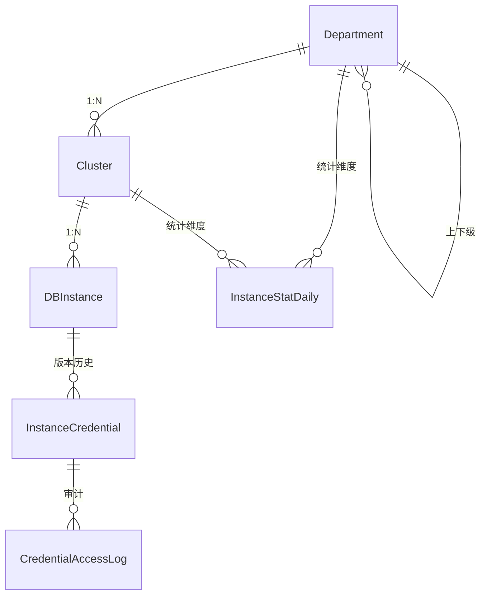

# 数据库实例管理系统

面向企业内部的数据库资产纳管平台：登记 **部门 → 集群 → 实例** 三级资产，维护账号密码并定时轮换，
探测实例端口连通性，按天产出统计报表，并对每个请求的耗时做观测。


<!-- 推送到 GitHub 后，把 OWNER/REPO 换成实际地址即可显示 CI 状态

-->

---

## 一分钟上手

```bash
git clone <this-repo> && cd db_instance_manager

python -m venv venv
venv\Scripts\activate                # macOS/Linux: source venv/bin/activate
pip install -r requirements.txt -i https://pypi.tuna.tsinghua.edu.cn/simple

python manage.py migrate
python manage.py seed_demo           # 生成演示数据 + 演示账号
python manage.py runserver
```

**演示账号：`demo` / `Demo#2026`**（管理员权限，由 `seed_demo` 自动创建）。
想用自己的账号，再执行 `python manage.py createsuperuser` 即可。

| 地址 | 说明 |
|---|---|
| <http://127.0.0.1:8000/demo/> | **可视化控制台**（单页、零依赖，可点探测/轮换） |
| <http://127.0.0.1:8000/api/docs/> | **Swagger UI**，全部接口、参数与响应结构 |
| <http://127.0.0.1:8000/api/> | DRF 可浏览 API，可直接操作所有接口 |
| <http://127.0.0.1:8000/admin/> | Django Admin |

> 默认 SQLite，零配置即可跑通。需要 MySQL 时复制 `.env.example` 为 `.env`，改 `DB_ENGINE=mysql` 后重新 `migrate`。

---

## 从哪里开始看

如果只有五分钟，建议按这个顺序：

| # | 文件 | 值得看的地方 |
|---|---|---|
| 1 | [`inventory/models.py`](inventory/models.py) | 六张表的约束设计：为什么凭据要独立成表并带版本 |
| 2 | [`inventory/services/rotation.py`](inventory/services/rotation.py) | 密码轮换的一致性处理：顺序、幂等、并发、补偿 |
| 3 | [`core/middleware.py`](core/middleware.py) | 请求耗时统计，以及「中间件为什么收不到视图异常」 |
| 4 | [`config/settings.py`](config/settings.py) | Celery 调度为什么必须用 `crontab`，生产自检 |
| 5 | [`tests/test_rotation.py`](tests/test_rotation.py) | 补偿回滚、并发跳过、多账号独立轮换 |

```bash
python manage.py test        # 68 个用例，约 30 秒
ruff check .                 # 静态检查
```

---

## 需求与实现的对应关系

| # | 题目要求 | 实现位置 | 关键点 |
|---|---|---|---|
| 1 | 实例 / 集群 / 部门模型 | `inventory/models.py` | 三级归属 + 唯一约束 + 端口范围校验 |
| 2 | 增删改查 + TCP 探测 | `inventory/views.py`<br>`inventory/services/tcp_probe.py` | 4 个 ViewSet；socket 三次握手 + 线程池批量探测 |
| 3 | 12 小时轮换密码并加密记录 | `inventory/services/rotation.py`<br>`inventory/services/drivers.py` | Fernet 加密、版本历史、先改远端、失败补偿 |
| 4 | 每天 00:00 按部门×集群统计 | `inventory/services/stats.py`<br>`config/settings.py` | `crontab(hour=0)`、一次 GROUP BY、0 值补齐 |
| 5 | 统计请求耗时的中间件 | `core/middleware.py` | `perf_counter`、响应头、慢请求告警 |

---

## 数据模型



| 表 | 说明 | 关键约束 |
|---|---|---|
| `department` | 部门，支持父子层级 | `code` 唯一 |
| `cluster` | 集群，归属部门 | `(department, name)` 唯一 |
| `db_instance` | 实例，逻辑上就是一个 `host:port` | `(cluster, name)` 唯一、`(host, port)` 全局唯一、端口 1–65535 |
| `instance_credential` | 账号凭据，**只存密文**，按版本留痕 | `(instance, username, version)` 唯一；每账号仅一条 `is_current` |
| `credential_access_log` | 明文查看 / 轮换审计 | 记录操作人、IP、UA |
| `instance_stat_daily` | 按「日期 × 部门 × 集群」的日报快照 | `(stat_date, cluster)` 唯一 |

**为什么凭据要单独建表？**
轮换的本质是「产生新版本、旧版本作废」，不是覆盖一个字段。独立成表才能保留历史、支持回滚、
做审计追溯。否则一旦密码改错，连「上一版是什么」都查不到。

---

## API

所有接口需要认证：`POST /api/auth/login/` 换取 Token，之后带 `Authorization: Token <key>`。

在线文档由 **drf-spectacular** 生成，启动后访问 `/api/docs/`（Swagger UI，可直接调试），
或 `/api/schema/` 获取 OpenAPI 3.0 描述文件，可直接导入 Postman / Apifox。

| 方法 | 路径 | 说明 |
|---|---|---|
| POST | `/api/auth/login/` | 用户名密码换 Token（10/min 限流） |
| GET/POST | `/api/departments/` | 部门列表 / 创建 |
| GET/PUT/PATCH/DELETE | `/api/departments/{id}/` | 部门详情 / 更新 / 删除 |
| GET | `/api/departments/{id}/clusters/` | 部门下集群（分页） |
| GET/POST | `/api/clusters/` | 集群列表 / 创建 |
| GET | `/api/clusters/{id}/instances/` | 集群下实例（分页） |
| GET/POST | `/api/instances/` | 实例列表 / 创建 |
| POST | `/api/instances/{id}/probe/` | 探测单实例 TCP 可达性 |
| POST | `/api/instances/probe-batch/` | 批量探测（最多 100 个，线程池并发） |
| POST | `/api/instances/{id}/rotate-password/` | 手动轮换（管理员） |
| GET | `/api/credentials/` | 凭据列表（只读，密码恒为 `********`） |
| POST | `/api/credentials/{id}/reveal/` | 查看明文（管理员，强制审计） |
| GET | `/api/credentials/{id}/access_logs/` | 该凭据的操作记录 |
| GET | `/api/stats/daily/` | 日报查询，可按 `stat_date` / `department` / `cluster` 过滤 |
| GET | `/api/stats/daily/by-department/` | 按部门汇总某天数据 |
| POST | `/api/stats/daily/rebuild/` | 补跑某天统计（管理员，幂等） |

列表接口统一支持 `?search=`、`?ordering=`、`?page=`、`?page_size=`。

```bash
TOKEN=$(curl -s -X POST http://127.0.0.1:8000/api/auth/login/ \
  -H "Content-Type: application/json" \
  -d '{"username":"admin","password":"your-password"}' | python -c "import sys,json;print(json.load(sys.stdin)['token'])")

curl -H "Authorization: Token $TOKEN" http://127.0.0.1:8000/api/instances/
curl -X POST -H "Authorization: Token $TOKEN" http://127.0.0.1:8000/api/instances/1/probe/
```

---

## 设计说明

### 1. 模型与接口

四个 ViewSet + Router，标准 REST 语义，不做 `{code, msg, data}` 包装（包装会让分页、文件下载、
第三方 SDK 都变别扭，错误结构已在 `core/exceptions.py` 统一）。

列表接口统一用 `select_related` + `prefetch_related(Prefetch(..., to_attr=...))` 预取，
避免「查 N 个实例，再逐个查所属集群和当前凭据」的 N+1。

### 2. TCP 探测

- 用 `socket.create_connection((host, port), timeout)` 测三次握手是否完成。比 `ping` 准
  （ping 通不代表端口开），比 `telnetlib` 稳（后者 Python 3.13 已移除）。
- 用 `time.perf_counter()` 算握手 RTT。
- 结果回写 `status / last_probe_at / last_probe_latency_ms / last_probe_error`，用 `update_fields` 精确更新。
- 批量探测用线程池并发（默认 8）。**socket 在子线程，写库回主线程** —— Django 的 ORM 连接是线程绑定的。
- 错误分型返回：超时 / 连接被拒 / DNS 解析失败 / 其他网络错误，而不是笼统的 `false`。
- 按 `ScopedRateThrottle` 限流 60/min，防止被当成内网扫描器。

已知取舍：**DNS 解析耗时不受 socket timeout 约束**，域名异常时会超出预期。生产应加 DNS 缓存或预解析。

### 3. 密码轮换（核心）

**a. 必须真的改到目标库上。** 只生成随机串存进自己的库毫无意义——目标库还是旧密码，业务当场连不上。
因此抽象 `PasswordDriver`：`SimulatedDriver`（演示）与 `MySQLDriver`（真实执行 `ALTER USER`），
通过配置切换，业务代码不动。

**b. 一致性顺序**

```
生成新密码
  → 改远端（失败：本地不动，二者仍一致）
  → 远端成功后，短事务：旧版 is_current=False + 插入新版
  → 本地落库失败：补偿，把远端改回旧密码
  → 补偿也失败：CRITICAL 日志 + 人工介入，绝不假装成功
```

反过来「先写本地再改远端」，远端失败就会出现「本地记新密码、数据库还是旧密码」——最难排查的故障。

**c. 幂等**：任务可能重复投递。进入临界区后按最新落库时间**二次校验**是否真的到期，
重复执行结果是 `skipped`，不会连着改两次密码。

**d. 并发**：`select_for_update(skip_locked=True)` 串行化同一实例的轮换，
拿不到锁的 worker 直接跳过而非排队。SQLite 不支持行锁，用 `connection.features.has_select_for_update`
自动降级（仅限本地演示）。

**e. 密钥管理**：`Fernet`（AES-128-CBC + HMAC）加密，`MultiFernet` 支持密钥列表 ——
**第一个加密，全部解密**，换密钥不用停机刷全表。

**f. 明文出口只有一处**：`POST /api/credentials/{id}/reveal/`，需要 `is_staff`，
每次调用强制写审计日志。列表接口只返回 `********`，密文和明文都不出现在响应里。

### 4. 每日统计

- **调度用 `crontab(hour=0, minute=0)`，不是 `24 * 60 * 60` 秒**。后者语义是「距上次触发 24 小时」，
  beat 在 14:37 启动，统计就永远在 14:37 跑；进程重启一次，执行时间整体漂移一次。
- 一次 `GROUP BY` 拿到全部计数，再与集群全量表左连接，**没有实例的集群也写一条 0 值记录**，
  否则报表会出现「这个集群今天消失了」的断层。
- 幂等靠 `UniqueConstraint(stat_date, cluster)` + `update_or_create`，重跑是覆盖不是追加。
- 维表名称冗余存快照，部门/集群改名后历史报表仍是当时的名字（缓慢变化维）。
- 时区：`TIME_ZONE` 与 `CELERY_TIMEZONE` 都设 `Asia/Shanghai`，并用 `timezone.localdate()`。
  只设 Django 不设 Celery 的话，「每天 00:00」会变成 UTC 00:00，即北京时间早上 8 点。

### 5. 耗时中间件

放在 `MIDDLEWARE` 第一位（最外层），才能统计到包含全部中间件的端到端耗时。

- 响应头 `X-Request-Duration-ms`
- 结构化日志：`method / path / status / duration_ms / user_id`，超过 500ms 打 WARNING
- 5xx 请求按失败单独告警

三个坑：

1. **用 `perf_counter` 而不是 `time.time`**。后者会被 NTP 校时影响，可能出现负耗时。
2. **视图异常通常不会以异常形式到达中间件**。Django 用 `convert_exception_to_response` 包裹每层中间件，
   异常在下一层就变成 500 响应了。所以要同时用 `try/except` 和 `status_code >= 500` 双保险。
3. **流式响应**：`__call__` 返回只代表首字节就绪，真实传输耗时在迭代阶段。代码里标了 `streaming` 字段，
   避免污染普通请求的 P95。

生产上应接 Prometheus（`django-prometheus`），而不是只看日志。

---

## 测试

```bash
python manage.py test
# Ran 68 tests
```

| 文件 | 覆盖内容 |
|---|---|
| `test_models.py` | 加解密往返、密文不含明文、多密钥轮换、掩码 |
| `test_api.py` | 四个模型 CRUD、过滤搜索、字段校验、权限、凭据不泄露密码、明文查看审计、演示页与 OpenAPI 文档 |
| `test_probe.py` | 可达 / 超时 / 拒绝（mock socket）、状态回写、批量探测、匿名拦截 |
| `test_rotation.py` | 版本递进、旧版失效、驱动失败不动本地、dry-run、**补偿回滚**、并发跳过、多账号独立 |
| `test_stats.py` | 部门×集群聚合、0 值行、幂等重跑、状态变化覆盖、名称快照 |
| `test_middleware.py` | 响应头、健康检查豁免、异常请求留痕 |
| `test_tasks.py` | **调度必须是 crontab**、任务汇总与失败上报、空 ID 语义 |
| `test_commands.py` | `seed_demo` 幂等、自动建演示账号、不覆盖已改密码、自动补权 |

CI 见 [`.github/workflows/ci.yml`](.github/workflows/ci.yml)：Python 3.12/3.13 双版本跑 ruff + check + test。

---

## 目录结构

```
db_instance_manager/
├── config/
│   ├── settings.py          # 全部走环境变量，含生产自检
│   ├── celery.py
│   └── urls.py
├── core/                    # 与业务无关的基础设施
│   ├── crypto.py            # Fernet / MultiFernet 封装
│   ├── middleware.py        # 请求耗时中间件
│   ├── pagination.py
│   └── exceptions.py        # 统一错误结构
├── inventory/
│   ├── models.py            # 6 张表
│   ├── serializers.py
│   ├── views.py             # 4 个 ViewSet + 探测/轮换/明文查看
│   ├── urls.py
│   ├── tasks.py             # 两个 Celery 定时任务
│   ├── services/
│   │   ├── tcp_probe.py     # 端口探测
│   │   ├── drivers.py       # 改密驱动（模拟 / MySQL）
│   │   ├── rotation.py      # 轮换编排：锁、幂等、补偿
│   │   └── stats.py         # 日报聚合
│   ├── templates/demo.html  # 单页演示控制台
│   └── management/commands/seed_demo.py
├── tests/                   # 68 个用例
├── .github/workflows/ci.yml
├── ruff.toml
├── requirements.txt
└── .env.example
```

分层原则：`views` 只做参数校验与权限，`services` 承载业务与事务，`models` 只描述数据与约束。
换数据库驱动、加 CLI、跑定时任务，都复用同一套 service。

---

## 上生产还差什么

1. **密钥托管**：`FERNET_SECRETS` 由 KMS / Vault 注入，进程内存持有，不落库不进仓库。
2. **改密两阶段**：当前是「改远端 → 落本地 → 失败补偿」。更严谨的做法是先写 `pending` 记录（带新密文）
   → 改远端 → 确认，失败时由对账任务根据 pending 记录补齐，避免补偿也失败时的一致性空洞。
3. **分布式锁**：DB 行锁在单库下够用；多库场景建议 Redis 锁 + 短事务，避免网络调用期间长期持有行锁。
4. **观测**：耗时指标接 Prometheus + Grafana；轮换失败接告警。
5. **审计归档**：`credential_access_log` 定期归档到冷存储，保留期按合规要求设定。
6. **权限**：生产接企业 SSO；`reveal` 建议再加二次确认或审批流。

---

## License

[MIT](LICENSE)
